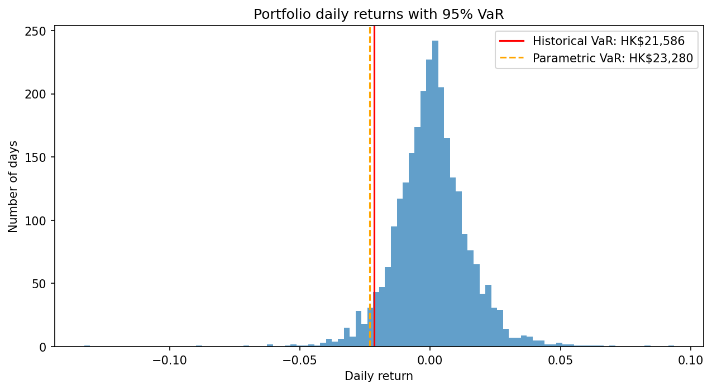
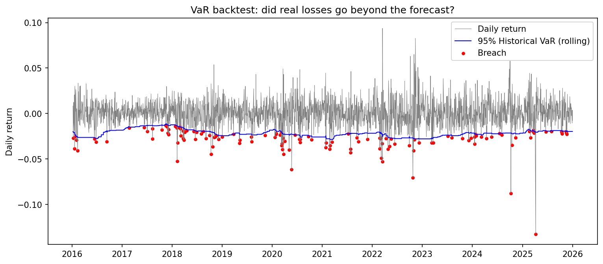
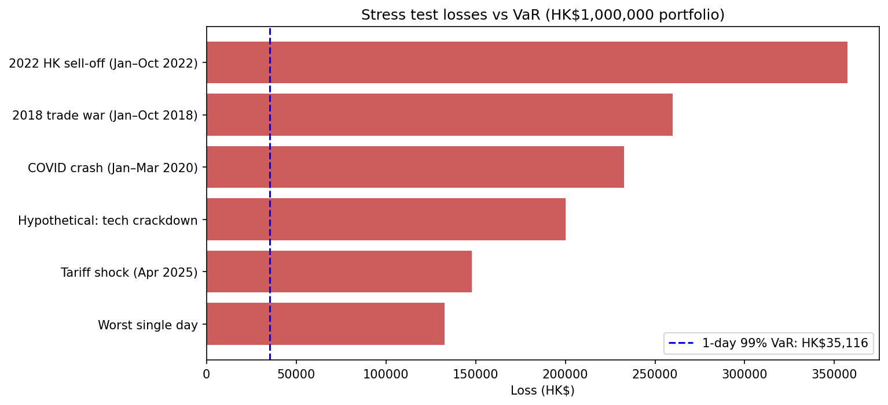

# Portfolio risk engine

How much could a HK$1,000,000 portfolio of five Hong Kong stocks lose on a bad day, and can that estimate be trusted? This project measures the risk with Value-at-Risk (VaR) and Expected Shortfall (ES), tests the model over 10 years without using future data, and compares it with real market crises.

## Data

- Daily adjusted closing prices from Yahoo Finance (yfinance), January 2015 to December 2025
- HSBC (0005.HK), HKEX (0388.HK), Tencent (0700.HK), AIA (1299.HK) and the Tracker Fund (2800.HK)
- Equal weights of 20%, rebalanced daily
- 2,707 daily returns after cleaning (one missing day removed)

## Method

1. Calculated daily returns, volatility and correlations for each stock and the portfolio (`01_data.ipynb`)
2. Estimated 1-day VaR at 95% and 99% with historical, parametric (normal) and Monte Carlo methods (`02_var.ipynb`)
3. Calculated Expected Shortfall and backtested daily VaR forecasts with a 250-day rolling window. Each forecast uses only data up to the previous day, which avoids look-ahead bias. Breach rates were checked with a binomial test (`03_backtest.ipynb`)
4. Ran stress tests on the worst historical day, four crisis periods and one hypothetical scenario, and measured the maximum drawdown (`04_stress_test.ipynb`)

## Results

### 1-day Value-at-Risk

| Confidence | Historical | Parametric | Monte Carlo |
|---|---|---|---|
| 95% | HK$21,586 | HK$23,280 | HK$23,260 |
| 99% | HK$35,116 | HK$33,155 | HK$33,275 |

At 95% the normal distribution gives a higher VaR than history, but at 99% it gives a lower one. Real returns have fat tails: more calm days and more extreme days than the normal distribution predicts.

At 95%, Expected Shortfall is HK$31,300, about 45% larger than VaR. At 99%, historical ES is HK$49,135, while the normal distribution predicts only HK$38,065, about 23% less, which confirms that the normal model underestimates losses on the worst days.

### Backtest, 2016 to 2025

| Level | Expected breaches | Historical | Parametric |
|---|---|---|---|
| 95% VaR | 5% | 5.37% (p = 0.40), pass | 4.60% (p = 0.38), pass |
| 99% VaR | 1% | 1.22% (p = 0.26), pass | 1.55% (p = 0.01), fail |

Breaches cluster in crisis years: 10.6% of days in 2018, 7.7% in 2020 and 6.9% in 2022, compared with about 3% in calm years.

### Stress tests

| Scenario | Loss (HK$) | Times 99% VaR |
|---|---|---|
| Worst single day (7 April 2025) | 132,854 | 3.8 |
| 2018 trade war (Jan to Oct 2018) | 259,731 | 7.4 |
| COVID crash (Jan to Mar 2020) | 232,685 | 6.6 |
| 2022 Hong Kong sell-off (Jan to Oct 2022) | 357,230 | 10.2 |
| Tariff shock (April 2025) | 147,958 | 4.2 |
| Hypothetical tech crackdown | 200,000 | 5.7 |

Maximum drawdown: -48.5% (lowest point on 28 October 2022). Crisis dates are approximate.

## Key findings

1. The normal-distribution model underestimates extreme losses. It failed the 99% backtest (1.55% breaches against 1% expected, p = 0.011), while historical VaR passed every test.
2. VaR reacts slowly. A 250-day window still reflects calm markets when a crisis starts, so breaches cluster at the beginning of crises.
3. One extreme day can distort the parametric model. After the April 2025 crash, higher estimated volatility made parametric VaR too cautious, with only 0.8% breaches in 2025.
4. Real crises cost 4 to 10 times the 1-day 99% VaR, and the portfolio fell 48.5% from its peak at the worst point in 2022. VaR needs to be used together with stress tests and drawdown analysis.

## Limitations and possible improvements

- Monte Carlo draws from a normal distribution, so it repeats the parametric result. Simulating each stock with the correlation matrix, or resampling real days, would make it more useful.
- EWMA or GARCH volatility would let VaR react faster to new market conditions.
- The Tracker Fund holds the other four stocks, so part of the risk is counted twice.
- The binomial test counts breaches but does not check whether they cluster. A Christoffersen test would.
- Transaction costs, currency effects and weight drift are ignored.

## How to run

Open any notebook in Google Colab and choose Runtime → Run all. The notebooks load `returns.csv` from this repository, so results can be reproduced without downloading new data.

## Tools

Python, pandas, NumPy, SciPy, Matplotlib, Google Colab
